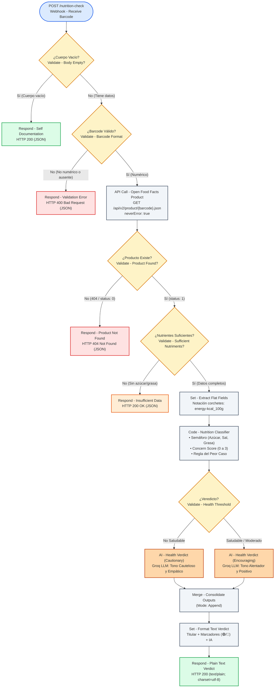

# Diagrama de Arquitectura y Flujo — SnackCheck

Este documento detalla el diseño de flujo y las ramificaciones lógicas de la automatización **SnackCheck**. 

Archivos asociados para inspección visual y edición:
- Formato editable en Excalidraw: [`snackcheck_diagram.excalidraw`](file:///c:/Users/sergi/Downloads/temp/snackcheck_diagram.excalidraw) (arrastrar directamente en [excalidraw.com](https://excalidraw.com)).
- Formato vectorial directo: [`snackcheck_diagram.svg`](file:///c:/Users/sergi/Downloads/temp/snackcheck_diagram.svg).

---

## 1. Diagrama de Flujo (Mermaid)



---

## 2. Diagrama Estructurado (ASCII Art)

```text
                         [Webhook - Receive Barcode]
                                      │ (POST /nutrition-check)
                                      ▼
                          [Validate - Body Empty?]
                             /                \
               (Cuerpo vacío)                  (Con cuerpo)
                     │                              │
          [Respond - Self Docs]                     ▼
               (HTTP 200)               [Validate - Barcode Format]
                                            /               \
                                    (Inválido)             (Válido)
                                        │                     │
                             [Respond - Validation]           ▼
                                   (HTTP 400)      [API Call - Open Food Facts]
                                                       (GET /api/v2/product/...)
                                                           /              \
                                                      (HTTP 404)       (HTTP 200)
                                                          │                 │
                                                [Respond - Not Found]       ▼
                                                     (HTTP 404)     [Validate - Sufficient Nutriments?]
                                                                         /                    \
                                                                    (Vacíos)                (Completos)
                                                                       │                         │
                                                         [Respond - Insufficient Data]           ▼
                                                                   (HTTP 200)        [Set - Extract Flat Fields]
                                                                                                 │
                                                                                                 ▼
                                                                                    [Code - Nutrition Classifier]
                                                                                                 │
                                                                                                 ▼
                                                                                    [Validate - Health Threshold]
                                                                                        /                  \
                                                                                (No Saludable)        (Saludable/Mod)
                                                                                      │                      │
                                                                               [AI Cautionary]        [AI Encouraging]
                                                                                      \                      /
                                                                                       ▼                    ▼
                                                                                     [Merge - Consolidate Outputs]
                                                                                                   │
                                                                                                   ▼
                                                                                      [Set - Format Text Verdict]
                                                                                                   │
                                                                                                   ▼
                                                                                     [Respond - Plain Text Verdict]
                                                                                               (HTTP 200)
```

---

## 3. Descripción de Bloques Funcionales y Convención de Nombres

Cada nodo sigue estrictamente el estándar `[Acción] - [Propósito]`:

1. **`Webhook - Receive Barcode`**: Punto de entrada HTTP expuesto en el puerto de n8n para peticiones POST.
2. **`Validate - Body Empty?`**: Evalúa si el payload carece de propiedades con `Object.keys($json.body || {}).length === 0`.
3. **`Respond - Self Documentation`**: Retorna el manual interactivo del servicio en JSON con código 200.
4. **`Validate - Barcode Format`**: Filtra mediante expresión regular que el código posea únicamente dígitos enteros.
5. **`Respond - Validation Error`**: Responde 400 Bad Request si la sintaxis del código es errónea.
6. **`API Call - Open Food Facts Product`**: Efectúa la llamada HTTP a Open Food Facts con protección `neverError: true`.
7. **`Validate - Product Found?`**: Discrimina el flag `status === 0` de Open Food Facts.
8. **`Respond - Product Not Found`**: Devuelve 404 Not Found cuando el artículo no consta en la base de datos abierta.
9. **`Validate - Sufficient Nutriments?`**: Previene la emisión de clasificaciones con registros sin macronutrientes.
10. **`Respond - Insufficient Data`**: Notifica en formato JSON que no es posible auditar el producto por falta de datos.
11. **`Set - Extract Flat Fields`**: Desanida las propiedades y utiliza notación de corchetes para `nutriments['energy-kcal_100g']`.
12. **`Code - Nutrition Classifier`**: Ejecuta la lógica matemática del semáforo, el Nutri-Score, la puntuación de preocupación (0 a 3) y el veredicto del peor caso sobre un ítem único.
13. **`Validate - Health Threshold`**: Bifurca el flujo hacia el prompt de IA adecuado según la gravedad del veredicto.
14. **`AI - Health Verdict (Cautionary)`**: Genera la recomendación empática y precavida para productos no saludables.
15. **`AI - Health Verdict (Encouraging)`**: Genera la recomendación constructiva para snacks saludables y equilibrados.
16. **`Merge - Consolidate Outputs`**: Une las ramas de ejecución con el modo *append*.
17. **`Set - Format Text Verdict`**: Da estructura visual al veredicto incorporando titular, emojis de semáforo y calorías.
18. **`Respond - Plain Text Verdict`**: Entrega el veredicto definitivo en texto plano con código HTTP 200.
